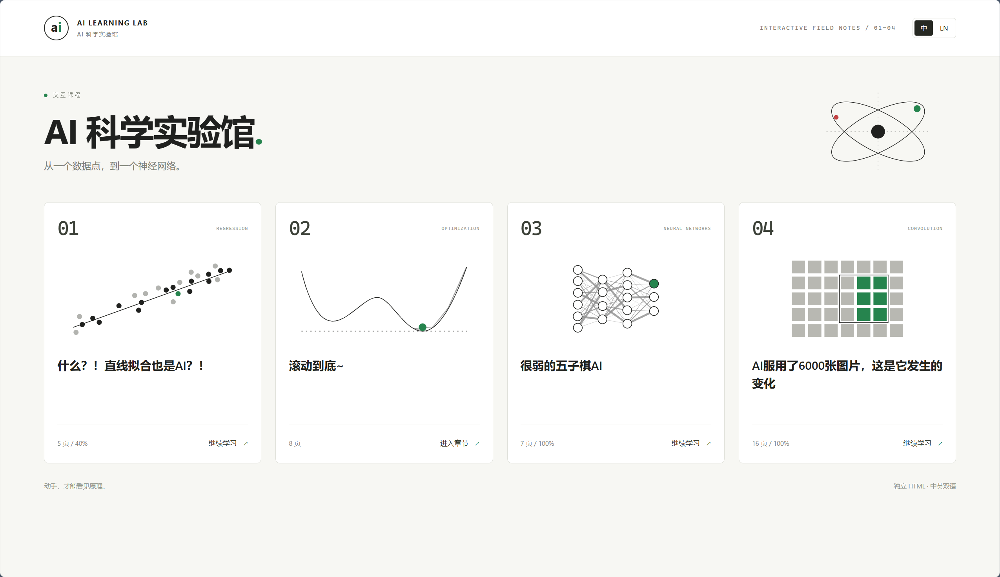
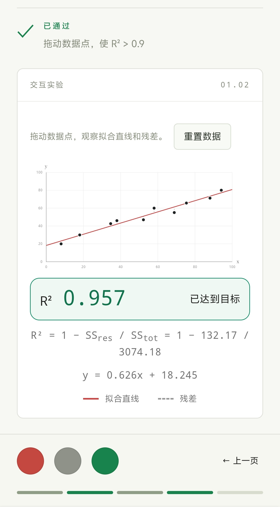
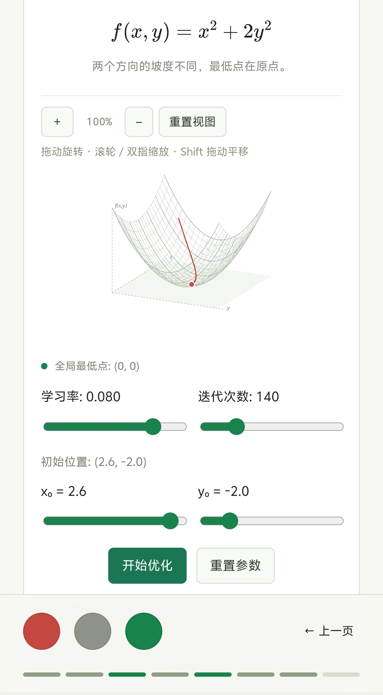
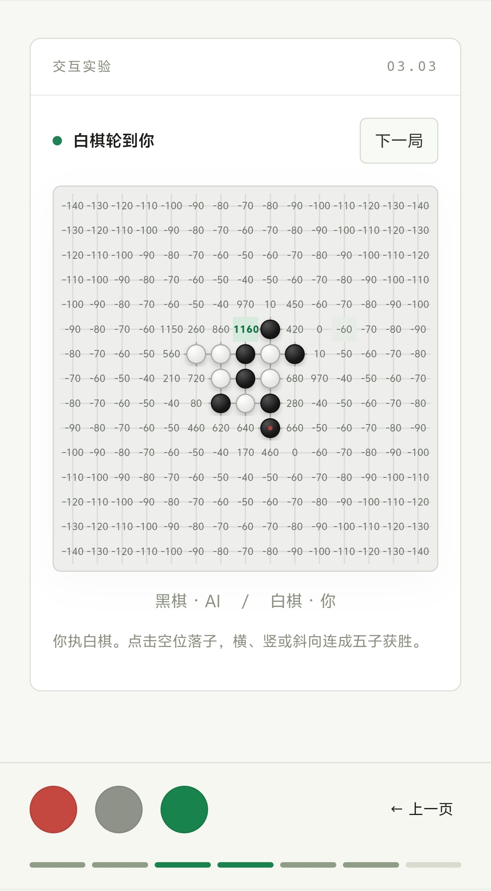
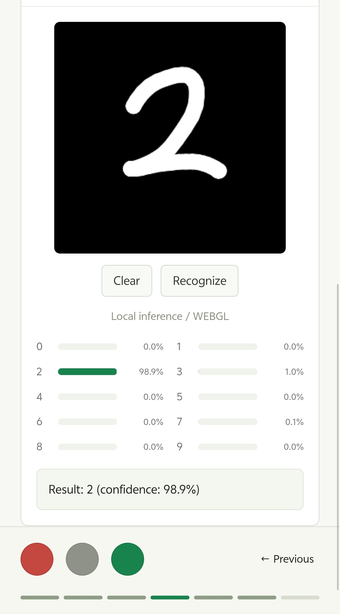
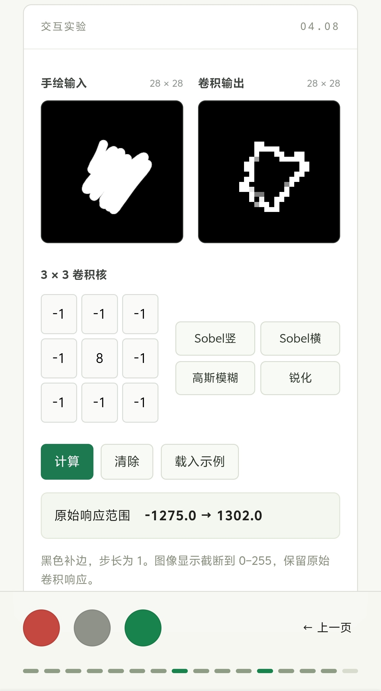
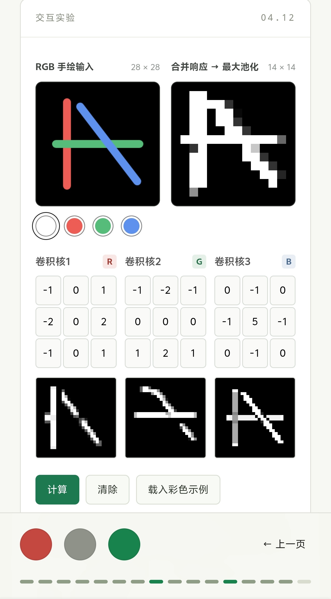
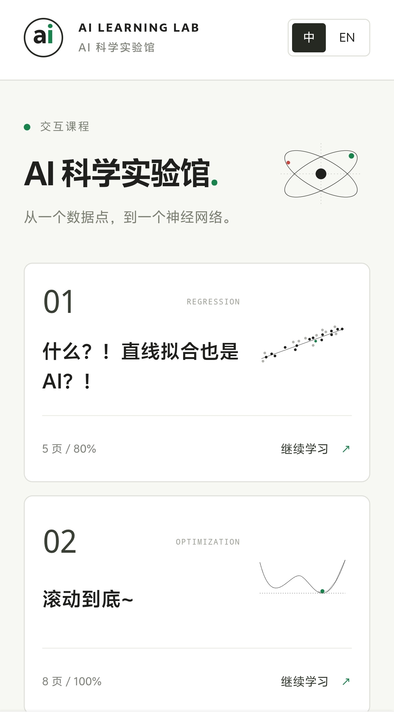
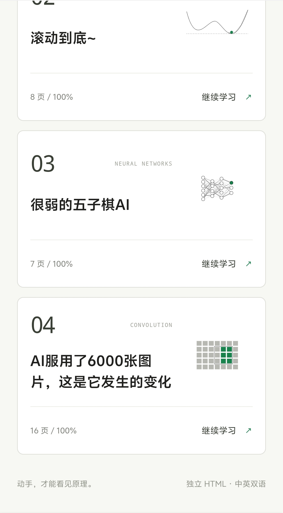
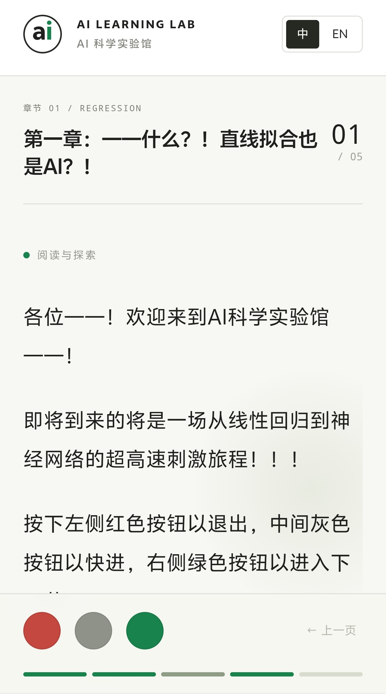

# AI Science Lab · AI 科学实验馆

> 从一个数据点，到一个神经网络。

AI Science Lab 是一个面向 AI 入门学习者的交互式科普项目。它把线性回归、梯度下降、神经网络和卷积神经网络串成一场逐页展开的导览：先读一段讲解，再亲手拖动数据点、调整参数、落子或画图，观察算法如何给出结果。

项目目前包含 **4 个章节、36 页导览、8 个交互实验组件**，支持中英文切换、横竖屏布局与单文件 HTML 导出。手写数字识别直接在浏览器内运行，导出的课程可以独立保存和分享。



## 快速体验

1.**任何系统和环境**：直接下载并使用浏览器打开完整的单html文件[`dist/ai-learning-lab.html`](dist/ai-learning-lab.html)

2.**Windows**：下载仓库后，双击 [`start.cmd`](start.cmd)，通过源代码启动简易服务器，打开浏览器，进入章节选择页。

浏览导出文件不需要安装 Node.js、Python 或配置后端服务。页面使用的脚本、样式、数学字体、SVG、中英文文稿与模型权重都已内嵌到 HTML 中。使用源代码可重新构建完整html进行更新。

| 文件 | 用途 |
| --- | --- |
| [`dist/ai-learning-lab.html`](dist/ai-learning-lab.html) | 全部四章的整合版，便于作为单个文件分享 |
| [`dist/index.html`](dist/index.html) | 带章节选择的启动页，内含全部课程 |
| [`dist/chapter-01.html`](dist/chapter-01.html) | 第一章独立版 |
| [`dist/chapter-02.html`](dist/chapter-02.html) | 第二章独立版 |
| [`dist/chapter-03.html`](dist/chapter-03.html) | 第三章独立版 |
| [`dist/chapter-04.html`](dist/chapter-04.html) | 第四章独立版 |

每个章节文件都可以单独复制到其他设备，无需附带资源文件夹。浏览器会根据实际能力尝试使用 WebGPU、WebGL 或 CPU 进行模型推理。

## 课程内容

课程从“模型、输入输出、训练与评估”出发，逐步进入参数优化、棋型评分、手写识别和卷积计算。

| 章节 | 页数 | 主要内容与实验 |
| --- | --- | --- |
| 第一章：什么？！直线拟合也是 AI？！ | 5 | 拖动数据点观察拟合直线、残差和 R²；调整 AR 模型的两个系数，观察历史拟合与下一时刻预测 |
| 第二章：滚动到底～ | 8 | 用小球下滚理解梯度下降；比较不同函数、初始位置、学习率和迭代次数，观察局部与全局最小值 |
| 第三章：很弱的五子棋 AI | 7 | 与棋型评分 AI 对弈、查看候选落点分数；手写数字识别；通过图解认识神经网络的层、权重和计算关系 |
| 第四章：AI 服用了 6000 张图片，这是它发生的变化 | 16 | 从像素输入开始，逐步讲解卷积核、补边、池化、多通道、展平、加权输出与训练过程 |

### 回归与梯度下降

**线性回归**提供可拖动的数据点、实时拟合直线、残差和 R²。实验还单独处理竖直线 `x = k`、水平线与所有点重合的情况。

**AR 预测**使用前两项的加权和生成预测值。调整 `p`、`q`，即可比较历史数据、拟合结果与未来预测。

**梯度下降**提供两组可切换的目标函数：二维图中的双极小值、波纹碗形，以及三维图中的椭圆碗面、四谷曲面。学习率上限为 `0.1`；二维实验默认使用学习率 `0.025`、迭代 `200` 次、初始位置 `−3.0`。二维图支持平移和缩放，三维图支持旋转、缩放与平移。

<table>
  <tr>
    <td width="50%" align="center" valign="top">
      <p><strong>拖动数据点，观察拟合与通关反馈</strong></p>
      
    </td>
    <td width="50%" align="center" valign="top">
      <p><strong>旋转曲面，观察梯度下降轨迹</strong></p>
      
    </td>
  </tr>
</table>

### 五子棋与手写数字识别

**五子棋**包含普通对弈和评分可视化两种模式。AI 会根据连子数量、两端是否开放、进攻与防守权重以及离中心的距离计算落点得分；评分模式把候选位置的分数直接显示在棋盘上，便于观察每一步选择。

**手写数字识别**把画布缩放为 `28 × 28` 灰度输入，交给项目原有训练权重转换得到的 CNN，在浏览器内输出数字类别和十个类别的预测概率。画布处理与推理均在本地浏览器完成。

<table>
  <tr>
    <td width="50%" align="center" valign="top">
      <p><strong>看见五子棋 AI 眼中的落点分数</strong></p>
      
    </td>
    <td width="50%" align="center" valign="top">
      <p><strong>手写数字识别与类别概率分布</strong></p>
      
    </td>
  </tr>
</table>

### 从手绘输入到卷积与池化

**单通道卷积**可以直接手绘输入图像，编辑 `3 × 3` 卷积核，或选择 Sobel 竖向、Sobel 横向、高斯模糊和锐化预设。实验保留原始卷积响应，并把响应映射为可查看的灰度图。

**RGB 多通道卷积**提供彩色画笔、三个可编辑卷积核和分通道响应图。三个通道分别卷积后相加，经过 ReLU，再进行 `2 × 2` 最大池化，得到 `14 × 14` 输出。卷积系数支持负数、小数，并对非法输入与数值溢出进行检查。

<table>
  <tr>
    <td width="50%" align="center" valign="top">
      <p><strong>编辑卷积核，比较不同图像处理效果</strong></p>
      
    </td>
    <td width="50%" align="center" valign="top">
      <p><strong>观察 RGB 分通道响应与池化结果</strong></p>
      
    </td>
  </tr>
</table>

## 阅读与操作

页面以黑白为主，使用红、绿、灰作为操作与状态点缀。讲解逐段、逐字展开，公式完整显示；实验与图解安排在对应的讲解页中。

| 控制方式 | 功能 |
| --- | --- |
| 左侧红色圆钮 | 退出当前章节，返回章节选择页 |
| 中间灰色圆钮 | 立即显示当前页全部讲解文字 |
| 右侧绿色圆钮 | 进入下一页；在章节末尾完成当前章节 |
| “上一页”与底部分页条 | 返回已经访问的页面 |
| 页面顶部“中 / EN” | 同步切换正文、实验控件、结果提示与图解语言 |
| 空格键 | 显示当前页全部文字 |
| 左右方向键 | 焦点不在实验控件中时翻页 |

线性回归页需要将 **R² 调整到大于 0.9**；两个梯度下降关卡需要收敛到当前函数的全局最小值，四谷曲面接受其中任意一个全局最小值。其余实验可自由探索。完成状态会保留，切换语言不需要重新过关，也不会清空当前实验数据。

横屏时文字与实验左右分栏，竖屏时上下排列；画布、棋盘与图表支持对应的触控操作。章节页码、已完成任务和语言偏好会记录在当前浏览器中。

<table>
  <tr>
    <td width="33%" align="center" valign="top">
      <p><strong>手机端章节入口</strong></p>
      
    </td>
    <td width="33%" align="center" valign="top">
      <p><strong>自动本地进度存储</strong></p>
      
    </td>
    <td width="33%" align="center" valign="top">
      <p><strong>逐页阅读模式</strong></p>
      
    </td>
  </tr>
</table>

## 技术实现

| 部分 | 实现方式 |
| --- | --- |
| 课程播放器 | Vue 3 + TypeScript，统一管理分页、逐字讲解、任务判定和进度 |
| 文稿与双语 | Markdown 配合稳定的页面 ID、段落 ID 和文案键；中英文共用实验逻辑 |
| 数学公式 | Markdown 数学语法与 KaTeX 渲染，公式字体随 HTML 一并内嵌 |
| 交互图形 | SVG 绘制图表、曲面和教学图解；Canvas 负责手绘采样与图像输入 |
| 视图操作 | 根据指针位置进行缩放、平移和三维投影旋转，兼容鼠标与双指手势 |
| 浏览器内推理 | TensorFlow.js，依次尝试 WebGPU → WebGL → CPU |
| 内容图形 | 11 幅教学 SVG 的中英文版本，以及 4 张可独立编辑的章节封面 |
| 单文件导出 | Vite 库模式构建，将应用脚本、CSS、字体、文稿、图解和模型资源内嵌到各个 HTML |

### 模型与推理

手写数字识别模型的结构为：

```text
28 × 28 × 1 灰度输入
  → Conv2D（32，3 × 3，ReLU）→ 最大池化
  → Conv2D（64，3 × 3，ReLU）→ 最大池化
  → Flatten（3136）→ Dense（128，ReLU）
  → Dense（10，Softmax）
```

模型包含 **421,642 个推理参数**，二进制权重为 **1,686,568 字节，约 1.61 MiB**。转换时直接保留原模型的推理张量，去除优化器状态；模型来源与哈希记录在 [`provenance.json`](src/assets/model/provenance.json) 中。

模型按需加载并复用；推理通过 `tf.tidy` 与显式释放输出张量管理临时资源。仓库提供原 Keras 模型的参考输出与一致性检查脚本，用于检查转换后的 TensorFlow.js 模型。

## 开发与构建

源码开发需要 **Node.js 22.12 或以上版本**及 npm。

```sh
npm install
npm run dev
```

修改文稿、Vue 组件或 SVG 后，重新导出 HTML：

```sh
npm run build
```

构建结果写入 `dist/`，可以再次通过启动器打开。需要通过本地 HTTP 服务查看构建产物时，可运行：

```sh
npm run preview
```

### 检查命令

| 命令 | 检查内容 |
| --- | --- |
| `npm run check` | 四章中英文页序、段落对应关系与公式渲染 |
| `npm run check:gradient` | 函数梯度、最低点、收敛示例、组件渲染、视图手势及动画状态逻辑 |
| `npm run check:labs` | 数值输入、卷积溢出保护及线性回归边界情况 |
| `node scripts/check-model.mjs` | 转换模型与原 Keras 模型参考输出的一致性 |

## 项目结构

```text
content/                    中英文课程文稿
screenshots/                项目截图
src/
  App.vue                   章节入口与课程播放器
  components/labs/          8 个实验组件及共用控件
  lib/                      文稿解析、数值计算、手势与推理逻辑
  assets/
    covers/                 4 张可编辑章节封面 SVG
    illustrations/          中英文教学 SVG
    model/                  模型结构、权重、来源记录与参考输出
scripts/                    单文件构建、模型转换与检查脚本
docs/                       改进记录与数值处理说明
dist/                       独立章节与整合版 HTML
start.cmd                   Windows 启动器
```

- **修改讲解与翻译**：编辑 `content/chapter-XX-zh.md` 和 `content/chapter-XX-en.md`，保留页面、段落及文案 ID 的对应关系。
- **修改封面与图解**：编辑 `src/assets/covers/`、`src/assets/illustrations/` 中的 SVG；页面直接使用这些源文件，导出 HTML 需要重新构建。
- **修改实验**：在 `src/components/labs/` 中调整 Vue 组件，相关计算与共用逻辑位于 `src/lib/`。

