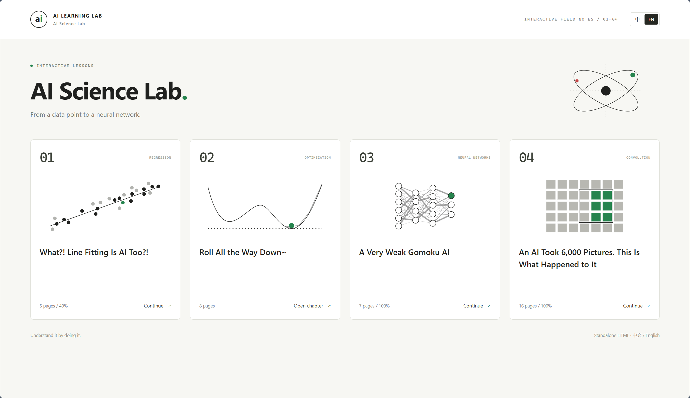
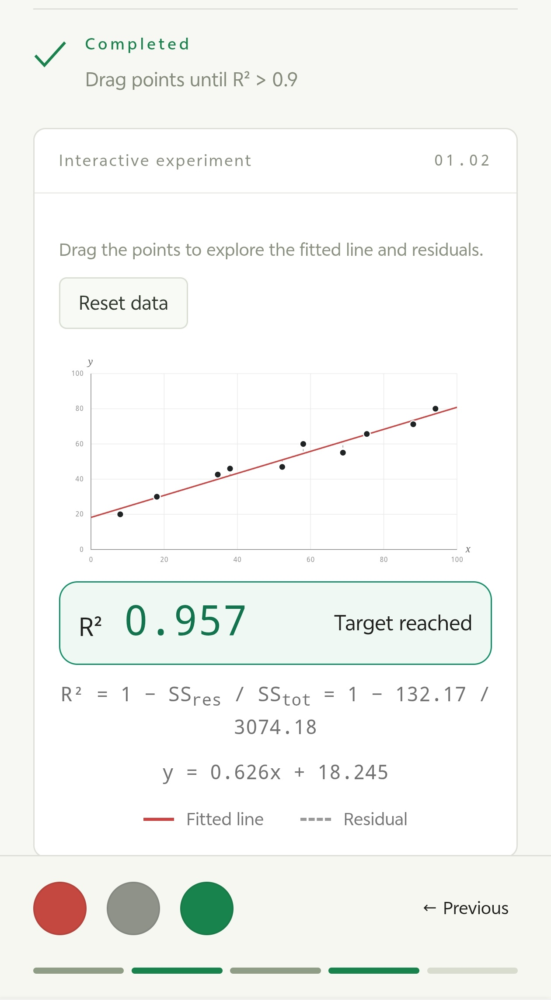
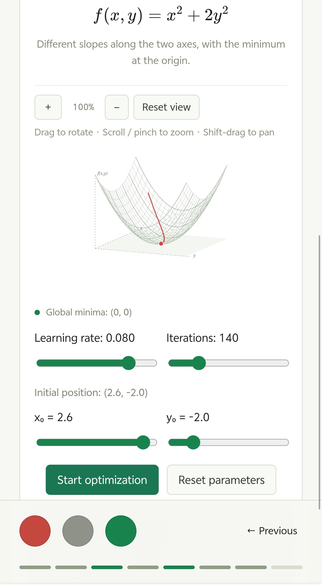
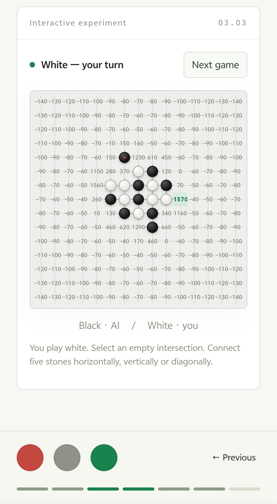
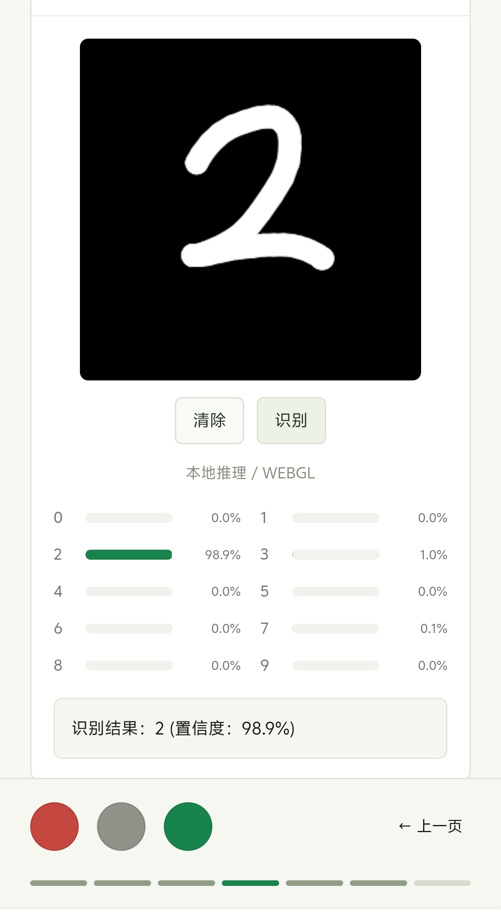
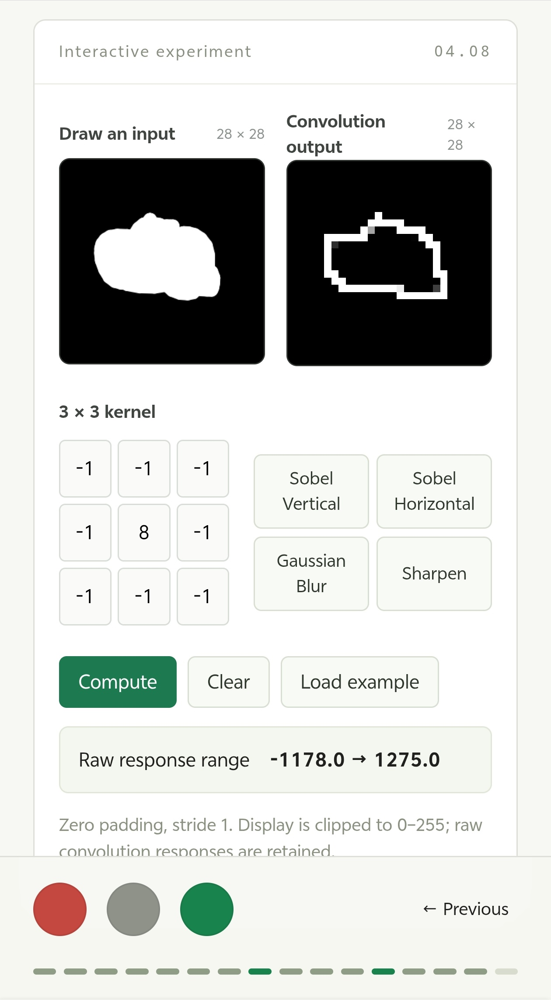
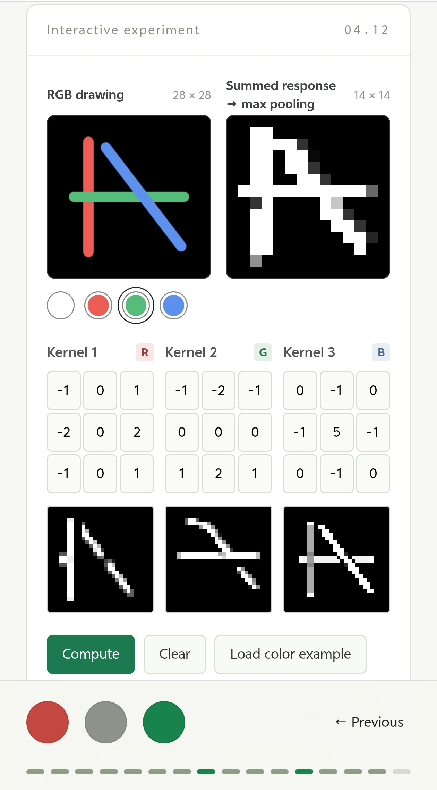
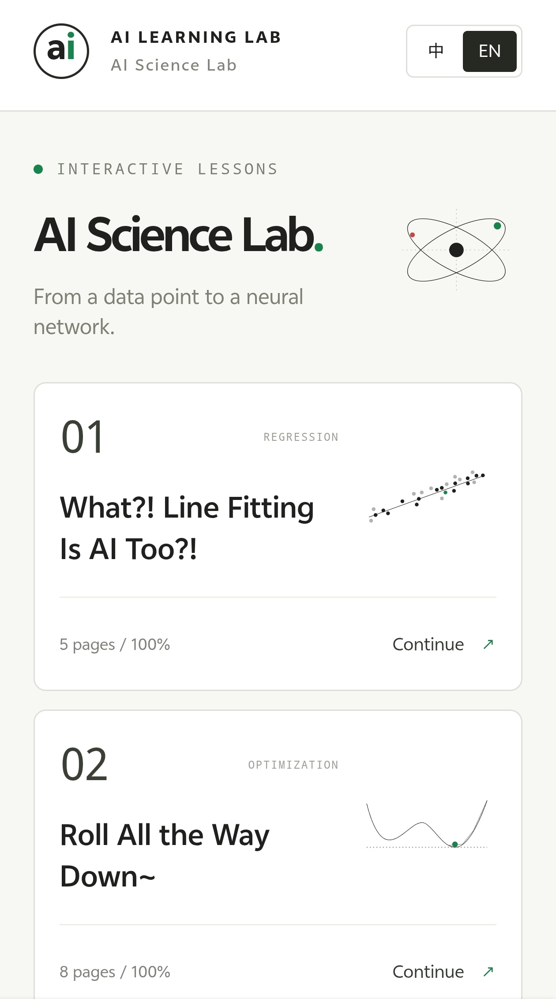
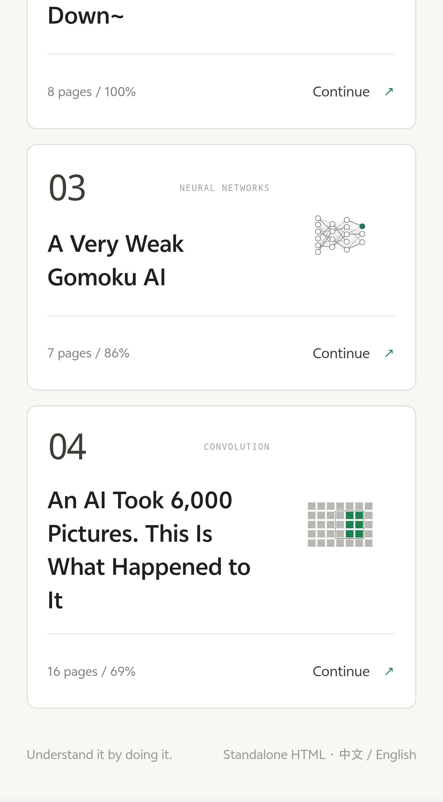
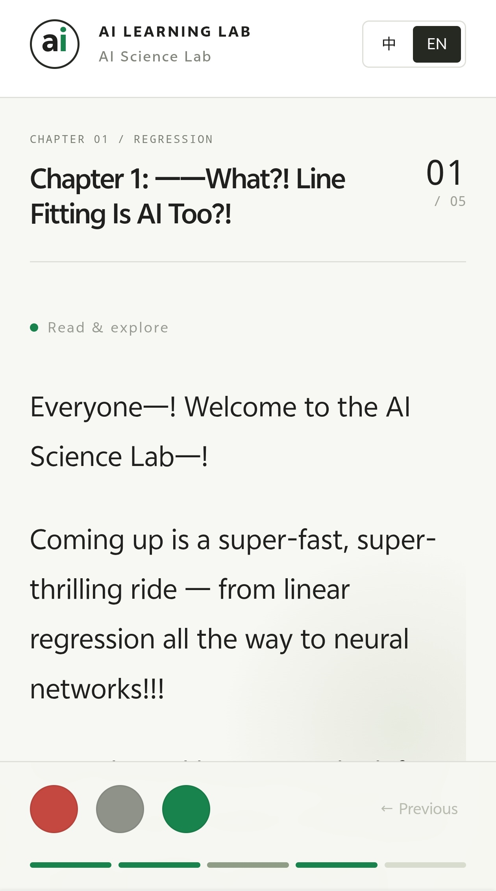

# AI Science Lab · AI 科学实验馆

**English** | [简体中文](README-zh.md)

> From a single data point to a neural network.

AI Science Lab is an interactive science-outreach project for beginners learning AI. It strings linear regression, gradient descent, neural networks, and convolutional neural networks into a page-by-page guided tour: read a piece of narration, then drag data points, tune parameters, place stones, or draw—watching how the algorithm produces its result.

The project currently includes **4 chapters, 36 tour pages, and 8 interactive experiment modules**, with English-Chinese switching, landscape/portrait layouts, and single-file HTML export. Handwritten digit recognition runs entirely in the browser, and the exported course can be saved and shared on its own.



## Quick Start

1. **Any system, any environment**: simply download and open the complete single HTML file [`dist/ai-learning-lab.html`](dist/ai-learning-lab.html) in a browser.

2. **Windows**: download the repository, double-click [`start.cmd`](start.cmd) to launch a simple server from the source code, then open a browser and go to the chapter selection page.

Browsing the exported file requires no Node.js, Python, or backend setup. The scripts, styles, math fonts, SVGs, Chinese and English manuscripts, and model weights used by the pages are all embedded into the HTML. The full HTML can be rebuilt from the source code for updates.

| File | Purpose |
| --- | --- |
| [`dist/ai-learning-lab.html`](dist/ai-learning-lab.html) | All four chapters combined, convenient to share as a single file |
| [`dist/index.html`](dist/index.html) | Launcher page with chapter selection, containing all courses |
| [`dist/chapter-01.html`](dist/chapter-01.html) | Chapter 1 standalone |
| [`dist/chapter-02.html`](dist/chapter-02.html) | Chapter 2 standalone |
| [`dist/chapter-03.html`](dist/chapter-03.html) | Chapter 3 standalone |
| [`dist/chapter-04.html`](dist/chapter-04.html) | Chapter 4 standalone |

Each chapter file can be copied to other devices on its own, with no resource folders needed. The browser attempts model inference with WebGPU, WebGL, or CPU depending on its actual capabilities.

## Course Content

The course starts from "model, inputs and outputs, training and evaluation", and gradually moves into parameter optimization, pattern scoring, handwriting recognition, and convolution.

| Chapter | Pages | Main content and experiments |
| --- | --- | --- |
| Chapter 1: What?! Line Fitting Is AI Too?! | 5 | Drag data points to observe the fitted line, residuals, and R²; tune the two coefficients of the AR model and watch the history fit and the next-step forecast |
| Chapter 2: Roll All the Way Down~ | 8 | Understand gradient descent through a rolling ball; compare different functions, initial positions, learning rates, and iteration counts, and observe local vs. global minima |
| Chapter 3: A Very Weak Gomoku AI | 7 | Play against a pattern-scoring AI and view candidate move scores; handwritten digit recognition; learn about neural network layers, weights, and computation through diagrams |
| Chapter 4: An AI Took 6,000 Pictures. This Is What Happened to It | 16 | Starting from pixel input, step-by-step coverage of kernels, padding, pooling, multi-channel convolution, flattening, weighted output, and the training process |

### Regression and Gradient Descent

**Linear regression** offers draggable data points, a real-time fitted line, residuals, and R². The experiment also handles the vertical line `x = k`, horizontal lines, and the case where all points coincide.

**AR forecasting** generates predictions from a weighted sum of the previous two terms. Adjust `p` and `q` to compare the historical data, the fitted values, and the future forecast.

**Gradient descent** provides two switchable target functions: a two-minima curve and a rippled bowl in the 2D plot, plus an elliptical bowl and a four-valley surface in the 3D plot. The learning rate is capped at `0.1`; the 2D experiment defaults to learning rate `0.025`, `200` iterations, and initial position `−3.0`. The 2D plot supports panning and zooming; the 3D plot supports rotation, zooming, and panning.

<table>
  <tr>
    <td width="50%" align="center" valign="top">
      <p><strong>Drag data points and watch the fit and pass feedback</strong></p>
      
    </td>
    <td width="50%" align="center" valign="top">
      <p><strong>Rotate the surface and watch the gradient descent path</strong></p>
      
    </td>
  </tr>
</table>

### Gomoku and Handwritten Digit Recognition

**Gomoku** includes two modes: normal play and score visualization. The AI scores each candidate move based on the number of connected stones, whether both ends are open, offense and defense weights, and distance from the center; the scoring mode displays candidate scores directly on the board, making every choice easy to observe.

**Handwritten digit recognition** scales the canvas to a `28 × 28` grayscale input and feeds it to a CNN converted from the project's original trained weights, outputting the digit class and the predicted probability of all ten classes directly in the browser. Canvas processing and inference are both done locally in the browser.

<table>
  <tr>
    <td width="50%" align="center" valign="top">
      <p><strong>See the move scores in the Gomoku AI's eyes</strong></p>
      
    </td>
    <td width="50%" align="center" valign="top">
      <p><strong>Handwritten digit recognition</strong></p>
      
    </td>
  </tr>
</table>

### From Hand-drawn Input to Convolution and Pooling

**Single-channel convolution** lets you draw the input image directly, edit the `3 × 3` kernel, or choose from the Sobel vertical, Sobel horizontal, Gaussian blur, and sharpen presets. The experiment keeps the raw convolution response and maps it into a viewable grayscale image.

**RGB multi-channel convolution** provides colored brushes, three editable kernels, and per-channel response maps. The three channels are convolved separately and summed, then passed through ReLU and `2 × 2` max pooling to produce the `14 × 14` output. Convolution coefficients support negative numbers and decimals, with checks for invalid input and numeric overflow.

<table>
  <tr>
    <td width="50%" align="center" valign="top">
      <p><strong>Edit kernels and compare different image processing effects</strong></p>
      
    </td>
    <td width="50%" align="center" valign="top">
      <p><strong>Observe per-channel RGB responses and pooling results</strong></p>
      
    </td>
  </tr>
</table>

## Reading and Controls

The pages are mostly black and white, with red, green, and gray as accents for actions and states. The narration unfolds paragraph by paragraph, character by character, with formulas fully displayed; experiments and illustrations are placed on their corresponding narration pages.

| Control | Function |
| --- | --- |
| Red circular button on the left | Exit the current chapter and return to the chapter selection page |
| Gray circular button in the middle | Immediately show all narration text on the current page |
| Green circular button on the right | Go to the next page; complete the current chapter at the end of a chapter |
| "Previous page" and the bottom page bar | Return to pages already visited |
| "中 / EN" at the top of the page | Switch narration, experiment controls, result messages, and illustrations between languages in sync |
| Spacebar | Show all text on the current page |
| Left/right arrow keys | Turn pages when focus is not on an experiment control |

The linear regression page requires **tuning R² above 0.9**; the two gradient descent levels require converging to the global minimum of the current function, and the four-valley surface accepts any one of its global minima. All other experiments can be explored freely. Completion status is preserved—switching languages does not require re-passing levels, nor does it clear the current experiment data.

In landscape, text and experiments are arranged in left and right columns; in portrait, they are stacked vertically. Canvas, board, and charts support the corresponding touch gestures. Chapter page numbers, completed tasks, and language preferences are recorded in the current browser.

<table>
  <tr>
    <td width="33%" align="center" valign="top">
      <p><strong>Mobile chapter entries</strong></p>
      
    </td>
    <td width="33%" align="center" valign="top">
      <p><strong>Local progress storage</strong></p>
      
    </td>
    <td width="33%" align="center" valign="top">
      <p><strong>Page-by-page reading</strong></p>
      
    </td>
  </tr>
</table>

## Technical Implementation

| Part | Implementation |
| --- | --- |
| Course player | Vue 3 + TypeScript, managing pagination, character-by-character narration, task judgment, and progress |
| Manuscripts and bilingual support | Markdown with stable page IDs, paragraph IDs, and copy keys; Chinese and English share the same experiment logic |
| Math formulas | Markdown math syntax rendered with KaTeX; formula fonts embedded along with the HTML |
| Interactive graphics | SVG for charts, surfaces, and teaching illustrations; Canvas for hand-drawn sampling and image input |
| View manipulation | Zoom, pan, and 3D projection rotation based on pointer position, compatible with mouse and two-finger gestures |
| In-browser inference | TensorFlow.js, trying WebGPU → WebGL → CPU in order |
| Content graphics | Chinese and English versions of 11 teaching SVGs, plus 4 independently editable chapter covers |
| Single-file export | Vite library-mode build, embedding app scripts, CSS, fonts, manuscripts, illustrations, and model assets into each HTML |

### Model and Inference

The handwritten digit recognition model has the following structure:

```text
28 × 28 × 1 grayscale input
  → Conv2D (32, 3 × 3, ReLU) → max pooling
  → Conv2D (64, 3 × 3, ReLU) → max pooling
  → Flatten (3136) → Dense (128, ReLU)
  → Dense (10, Softmax)
```

The model contains **421,642 inference parameters**, with binary weights of **1,686,568 bytes, about 1.61 MiB**. The conversion directly preserves the original model's inference tensors and removes optimizer states; the model source and hash are recorded in [`provenance.json`](src/assets/model/provenance.json).

The model is loaded on demand and reused; inference manages temporary resources through `tf.tidy` and explicit output-tensor disposal. The repository provides reference outputs from the original Keras model and a consistency-check script for checking the converted TensorFlow.js model.

## Development and Build

Source development requires **Node.js 22.12 or later** and npm.

```sh
npm install
npm run dev
```

After modifying manuscripts, Vue components, or SVGs, re-export the HTML:

```sh
npm run build
```

Build results are written to `dist/` and can be opened again via the launcher. To view the build output through a local HTTP server, run:

```sh
npm run preview
```

### Check Commands

| Command | What it checks |
| --- | --- |
| `npm run check` | Page order and paragraph correspondence for all four chapters in both languages, plus formula rendering |
| `npm run check:gradient` | Function gradients, lowest points, convergence examples, component rendering, view gestures, and animation state logic |
| `npm run check:labs` | Numeric input, convolution overflow protection, and linear regression edge cases |
| `node scripts/check-model.mjs` | Consistency of the converted model's output with the original Keras model's reference output |

## Project Structure

```text
content/                    Chinese and English course manuscripts
screenshots/                Project screenshots
src/
  App.vue                   Chapter entries and course player
  components/labs/          8 experiment components and shared controls
  lib/                      Manuscript parsing, numeric computation, gestures, and inference logic
  assets/
    covers/                 4 editable chapter cover SVGs
    illustrations/          Chinese and English teaching SVGs
    model/                  Model structure, weights, provenance records, and reference outputs
scripts/                    Single-file build, model conversion, and check scripts
docs/                       Improvement records and numeric handling notes
dist/                       Standalone chapter and combined HTML
start.cmd                   Windows launcher
```

- **Editing narration and translations**: edit `content/chapter-XX-zh.md` and `content/chapter-XX-en.md`, preserving the correspondence of page, paragraph, and copy IDs.
- **Editing covers and illustrations**: edit the SVGs in `src/assets/covers/` and `src/assets/illustrations/`; pages use these source files directly, and exported HTML needs to be rebuilt.
- **Editing experiments**: adjust the Vue components in `src/components/labs/`; related computation and shared logic lives in `src/lib/`.
